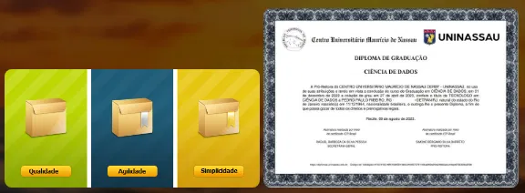

# 🏷️ Data Annotation em Python — Computação Clássica × Computação Quântica

📞 **Meus Contatos:** [www.inforpop.com](https://www.inforpop.com)
📱 WhatsApp: [55 21 99961-8643](https://wa.me/5521999618643)
✉️ Email: [inforpop@hotmail.com](mailto:inforpop@hotmail.com)
🔗 LinkedIn: [Pedro Paulo Ribeiro](https://www.linkedin.com/in/pedro-paulo-ribeiro-pcd-1451498/)



Projeto prático de **rotulagem de dados (Data Annotation)** com **pré-anotação assistida por modelo**,
gabarito para controle de qualidade e um **dashboard em Flask com duas abas**:

| Aba | Tarefa | Pré-anotação (modelo) | Gabarito |
|---|---|---|---|
| 💻 **Computação Clássica** | Sentimento de 20 textos em PT-BR: `positivo`, `neutro`, `negativo` | Classificador por léxico com negação | Rótulo definido no dataset |
| ⚛️ **Computação Quântica** | Estado final de 16 circuitos de 2 qubits: `base`, `superposição`, `emaranhado` | Heurística sintática ("H antes de CNOT ⇒ emaranhado") | Física: **concorrência** C = 2·\|ad − bc\| sobre o vetor de estado |

Os circuitos são **simulados em NumPy** (vetor de estado, portas H, X, Z, S, T, RY e CNOT) — sem Qiskit,
o que mantém o deploy leve. Alguns circuitos foram escolhidos para "enganar" a heurística
(ex.: `H` no qubit-alvo + `CNOT` não emaranha; `CNOT·CNOT` desfaz o emaranhamento).

## Métricas do dashboard

- **Progresso** da anotação
- **Acurácia humana** e **acurácia do modelo** em relação ao gabarito
- **κ (kappa) de Cohen** entre humano e modelo — concordância descontando o acaso
- **Correções** feitas sobre a pré-anotação e **tempo médio por item**
- **Distribuição dos rótulos**, **matriz de confusão** e, na aba quântica, **histograma das probabilidades de medição**
- Exportação **CSV** (abre no Excel com acentos) e **JSON**

Atalhos: `1` `2` `3` escolhem o rótulo · `Enter` aceita a sugestão do modelo.

## Estrutura

```
data-annotation-flask/
├── app.py                  # rotas Flask + API REST
├── annotation/
│   ├── classical.py        # dataset de textos + classificador por léxico
│   ├── quantum.py          # simulador de 2 qubits, concorrência, desenho ASCII
│   ├── metrics.py          # acurácia, kappa de Cohen, matriz de confusão
│   └── storage.py          # SQLite (biblioteca padrão)
├── templates/index.html    # dashboard com as duas abas
├── static/                 # CSS, JS (Chart.js) e a imagem anexada
├── tests/test_app.py       # testes com pytest
├── requirements.txt
├── Procfile                # gunicorn para o Heroku
└── .python-version         # versão do Python usada pelo Heroku
```

## API

| Método | Rota | Descrição |
|---|---|---|
| GET | `/api/<domain>/next?annotator=Nome` | Próximo item pendente (com sugestão do modelo) |
| POST | `/api/<domain>/annotate` | `{"item_id","label","annotator","seconds"}` → salva e devolve o gabarito |
| GET | `/api/<domain>/stats?annotator=Nome` | Métricas (sem `annotator` = todos) |
| POST | `/api/<domain>/reset` | Apaga as anotações do anotador |
| GET | `/api/<domain>/export.csv` · `.json` | Exportação |
| GET | `/health` | Verificação de saúde |

`<domain>` = `classical` ou `quantum`.

## Rodar localmente

```bash
python -m venv .venv
# Windows: .venv\Scripts\activate   |   Linux/Mac: source .venv/bin/activate
pip install -r requirements.txt
python app.py              # http://localhost:5000
pip install pytest && pytest -q
```

## Implantação no Heroku

```bash
heroku login
git init && git add . && git commit -m "Data Annotation: Clássica x Quântica"
heroku create data-annotation-pedro        # escolha um nome disponível
git push heroku main                       # ou: git push heroku master
heroku ps:scale web=1
heroku open
```

> ⚠️ O disco dos dynos do Heroku é **efêmero**: o arquivo SQLite é zerado quando o dyno reinicia
> (pelo menos uma vez por dia). Use os botões **Exportar CSV/JSON** para guardar as anotações.
> A variável `ANNOTATION_DB` permite apontar o banco para outro caminho.

---
Desenvolvido por **Pedro Paulo Ribeiro** — Bacharel em Ciência de Dados · [www.inforpop.com](https://www.inforpop.com)
